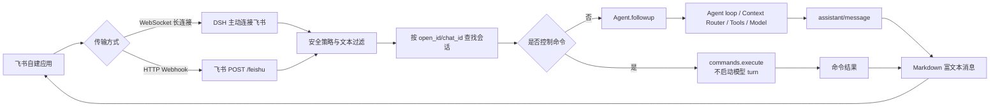

# 飞书机器人链路：从开放平台配置到 Agent 回复

[返回飞书快速配置指南](feishu-bot.zh.md)

本文从头到尾说明 DSH 的飞书机器人是如何工作的：飞书应用如何把消息交给 DSH，DSH 如何选择会话并调用 Agent，Agent 的回复如何再次回到飞书，以及配置、重启、权限和故障分别会影响哪一段链路。

本文描述的是当前实现。默认传输方式是飞书出站 WebSocket 长连接；HTTP Webhook 是备用方案。两条入口在消息进入 DSH 后共享同一套会话路由、命令短路和回复逻辑。

文中的“图片占位”先用说明块保留版式，不会引用不存在的图片文件。准备好截图后，建议统一放到 `docs/user/guide/images/feishu/`，再把占位块替换为 ``。

## 先看结论



> **图片占位 1｜全链路架构图**
>
> 建议文件名：`feishu-01-end-to-end.png`
>
> 建议画面：把上面的 Mermaid 图绘制成横向流程图，标出 WebSocket 与 HTTP Webhook 两条入口、会话路由、命令短路、Agent loop 和 Markdown 回复。
>
> 建议尺寸：`1600 x 900`，浅色背景，节点文字使用中英文关键字。

最重要的几个行为如下：

1. WebSocket 模式不需要公网回调地址；电脑主动连接飞书。
2. HTTP 模式需要公网 HTTPS 地址，并在 DSH 中注册精确的 `/feishu` 路由。
3. 私聊按发送者 `open_id` 复用 Agent，会话群聊按 `chat_id` 复用。
4. `/mode qa`、`/compact` 等控制命令在进入模型前执行，不会产生模型 turn。
5. 普通文本才会进入 Agent loop，模型完成后通过飞书 Markdown 富文本消息回复。
6. 当前聊天到 Session 的映射在内存中；重启 DSH 后，下一条消息会创建新的 Session。

## 一、准备飞书应用

### 1. 创建企业自建应用

在飞书开放平台创建企业自建应用并启用机器人能力。飞书后台的菜单名称可能随版本变化，但需要完成以下三类配置：

- 应用可以作为机器人收发消息。
- 事件订阅包含 `im.message.receive_v1`。
- 应用已经发布到当前企业可用的版本，且测试账号有权限使用它。

默认的 DSH 配置使用**长连接**模式。选择长连接后，飞书不要求你填写 DSH 的公网回调 URL；DSH 会从电脑主动连到飞书。

> **图片占位 2｜飞书应用基本配置**
>
> 建议文件名：`feishu-02-open-platform-app.png`
>
> 建议画面：飞书开放平台应用概览页，突出应用名称、App ID、机器人能力和应用状态。App Secret 必须打码。
>
> 安全要求：截图中不能出现完整 App Secret、Verification Token 或 Encrypt Key。

### 2. 选择消息传输方式

DSH 支持两种入口：

| 方式 | 飞书到 DSH 的路径 | 网络要求 | 适合场景 |
|---|---|---|---|
| `websocket` | DSH 主动建立飞书长连接 | DSH 能访问飞书 HTTPS/WSS | 默认方案、远程办公、无需公网入口 |
| `webhook` | 飞书向 DSH 的 `POST /feishu` 发请求 | DSH 必须有公网 HTTPS 地址 | 已有公网网关、反向代理或统一回调入口 |

两种方式后续都使用相同的 Agent 会话和回复代码。不要同时为同一套消息订阅启用两条入口，否则同一条消息可能被接收两次。

### 3. 准备凭据

至少需要：

- `App ID`
- `App Secret`

只有 `webhook` 方式还需要：

- `Verification Token`

`Encrypt Key` 当前不能让 DSH 解密加密的 HTTP callback body。代码会在配置了签名密钥时校验签名，但仍会明确拒绝需要解密的 body。因此首次接入建议使用 WebSocket；如果必须使用 HTTP，先在飞书侧关闭加密回调，或确认网关已经在 DSH 之前完成解密。

## 二、启动 DSH 并配置连接服务

### 1. 启动 Web 版 DSH

在项目根目录运行：

```sh
pnpm run dsh web --mobile --no-open
```

如果只在本机使用，可以省略 `--mobile`：

```sh
pnpm run dsh web --no-open
```

启动日志会打印带 token 的 Web 地址。`--mobile` 只影响 Web UI 的局域网访问，不是飞书身份验证；它不会替飞书建立连接，也不会把飞书消息改成 HTTP 模式。

> **图片占位 3｜DSH 启动日志**
>
> 建议文件名：`feishu-03-dsh-startup-url.png`
>
> 建议画面：终端中的 `dsh web:` 和可选的 `LAN:` 地址。URL 中的 token 可以局部打码，但要保留“服务已启动”的上下文。
>
> 不要把真实 token 发布到公共文档。

### 2. 打开连接服务

进入：

```text
设置 -> 连接服务 -> 飞书机器人
```

当前 Web UI 的飞书卡片包含以下字段：

| 字段 | 作用 | 当前默认/建议 |
|---|---|---|
| `App ID` | 飞书自建应用标识 | 必填 |
| `App Secret` | 飞书自建应用密钥 | 必填，写入凭据存储，不回显明文 |
| `Workspace path` | Agent 读写的本地工作区 | 使用绝对路径 |
| `Agent preset` | 每个飞书会话挂载的 Agent 组合 | 先使用 `standard` |
| `Permission preset` | 文件、命令和审批边界 | 先使用 `read-only` |
| `Require @mention in group chats` | 是否要求群聊必须 @机器人 | 默认开启 |

App ID 和 App Secret 是只写凭据。设置文件只保存凭据引用，例如 `DSH_FEISHU_APP_ID`，不会保存密钥明文。保存后页面只显示“已配置/未配置”状态。

> **图片占位 4｜连接服务中的飞书机器人卡片**
>
> 建议文件名：`feishu-04-settings-feishu-card.png`
>
> 建议画面：完整显示连接服务页面和飞书机器人卡片，突出 App ID、App Secret、工作区、Agent preset、Permission preset、群聊 @开关。凭据输入框中的值必须打码。
>
> 这张图是用户最需要的操作截图，建议放在本节之后。

### 3. 保存并重启

飞书插件的配置变更策略是 `restart`。因此正确顺序是：

1. 填写字段。
2. 点击保存。
3. 完整重启 DSH。
4. 观察启动日志中的飞书连接状态。

只刷新浏览器页面不会重新创建飞书连接。重启后插件会重新读取配置，创建连接服务，并等待飞书凭据可用。

## 三、DSH 启动时到底发生了什么

### WebSocket 模式

默认配置加载 `@deepseek-ai/dsh-webhook-feishu`，它依赖：

- `credentials`：读取 App ID 和 App Secret。
- `agents`：创建 Agent 实例。
- `agentPresets`：挂载 Agent preset。
- `permissionPresets`：设置会话权限策略。
- `workspaceRegistry`：创建并管理工作区。
- `commands`：执行 `/mode`、`/compact` 等人类控制命令。

如果凭据还没有配置，插件不会盲目连接，而是记录“等待 App ID 和 App Secret”的日志。凭据准备好并重启后，插件调用 Feishu SDK 建立 WebSocket 长连接，并开启：

- 群聊 @策略。
- 私聊 allowlist 策略（如果配置了 `allowedOpenIds`）。
- 重复事件去重。
- 单聊天消息队列，避免同一个聊天的消息交错处理。

> **图片占位 5｜WebSocket 连接成功日志**
>
> 建议文件名：`feishu-05-websocket-connected.png`
>
> 建议画面：终端中“connecting to Feishu over WebSocket”和“connected and listening”两类日志。
>
> 可补充一个飞书开放平台“长连接已连接”的后台状态截图。

### HTTP Webhook 模式

如果配置 `transport: webhook`，插件不会建立 WebSocket，而会让 DSH Web Server 注册精确路由 `/feishu`。飞书事件订阅地址应指向：

```text
https://你的域名/feishu
```

HTTP 入口只接受 `POST` 和 JSON。它在把 Agent 工作交给后台后尽快返回 `202`，不会等待模型完成。URL 验证请求会返回飞书要求的 `challenge`。

## 四、第一条消息进入 DSH 的全过程

### 1. 飞书侧产生事件

用户在私聊中发送文本，或在群聊中 @机器人并发送文本。事件至少包含：

- 事件 ID。
- 消息 ID。
- 发送者 `open_id`。
- `chat_id`。
- `chat_type`，通常是 `p2p` 或 `group`。
- 文本消息内容。

WebSocket 模式由 SDK 归一化后直接交给插件；Webhook 模式则先由 DSH 自己解析 v2 envelope，再提取文本内容。

### 2. 安全与准入检查

#### WebSocket

Feishu SDK 首先处理连接级策略。DSH 还会过滤：

- 非文本事件。
- 空文本。
- 不在 `allowedOpenIds` 中的私聊发送者。
- 开启 `requireMention` 时，未 @机器人的群聊消息。

#### Webhook

HTTP 入口按以下顺序处理：

1. 方法必须是 `POST`。
2. `Content-Type` 必须是 `application/json`，支持 UTF-8。
3. 请求 body 受 `maxBodyBytes` 限制，默认 1 MiB。
4. 校验 `Verification Token`。
5. 如果配置了 `Encrypt Key`，校验请求签名；需要解密的加密 body 当前仍会拒绝。
6. 解析 `im.message.receive_v1` 文本事件。
7. 执行 allowlist 和群聊 @检查。
8. 以 `202` 返回，并异步派发消息。

常见 HTTP 状态：

| 状态码 | 含义 |
|---:|---|
| `200` | URL verification 成功，返回 challenge |
| `202` | 消息已接收，Agent 将异步处理 |
| `400` | JSON、body 或加密回调格式错误 |
| `401` | Verification Token 或签名错误 |
| `403` | 发送者不在 allowlist |
| `405` | 不是 POST |
| `413` | body 超过上限 |
| `415` | Content-Type 不是 JSON |
| `503` | 凭据或回调处理服务不可用 |

> **图片占位 6｜飞书事件订阅配置**
>
> 建议文件名：`feishu-06-event-subscription.png`
>
> 建议画面：展示 `im.message.receive_v1` 已订阅，以及长连接/HTTP 回调模式的选择。Token、域名和应用敏感信息必须打码。
>
> WebSocket 文档只需要放长连接截图；HTTP 方案可另放一张回调 URL 截图。

## 五、会话路由：消息会进入哪个 Agent

收到消息后，插件先计算聊天目标：

| 聊天类型 | 会话键 | 结果 |
|---|---|---|
| 私聊 `p2p` | `open_id` | 同一个发送者复用一个 Agent |
| 群聊 `group` | `chat_id` | 同一个群复用一个 Agent |

内存中的 key 类似：

```text
open_id:ou_xxx
chat_id:oc_xxx
```

如果 key 已经绑定 Agent，消息直接进入该 Agent。如果是第一次出现，插件会依次：

1. 创建工作区对象。
2. 解析 Agent preset。
3. 读取模型选择。
4. 创建随机 Session ID：`feishu-${randomUUID()}`。
5. 把 Session 附加到工作区。
6. 设置 permission preset。
7. 把会话标题设为 `飞书 <receiveId>`。
8. 把聊天 key 和 Agent 绑定到内存 map。

同一聊天的并发第一条消息会共享 `pending` 创建 Promise，不会因为竞态创建两个绑定。

> **图片占位 7｜会话映射示意图**
>
> 建议文件名：`feishu-07-chat-session-mapping.png`
>
> 建议画面：左侧列出两个私聊发送者和一个群聊，右侧对应 `open_id`/`chat_id`、Session ID、Workspace 和 Agent。突出“私聊按人、群聊按群”。

### 重启后的重要限制

当前聊天 key 到 Session 的绑定只在进程内存中保存。重启 DSH 后：

- 旧 Session 日志可能仍在本地持久化存储中。
- 旧的聊天绑定不会自动读取。
- 同一个飞书聊天发来的下一条消息会创建新的随机 Session。
- 因此它表现为“重启后新对话”，不是自动续接旧上下文。

这是当前实现的明确限制，不是飞书端丢失消息。要实现重启续接，需要额外持久化 `chat key -> sessionId` 映射，并在启动时安全 resume。

## 六、控制命令与普通消息分流

这是本链路中最容易影响 Token 和行为的一步。

### 控制命令

以下输入会在 Agent loop 之前直接执行：

```text
/mode qa
/mode coding
/compact
```

插件调用 `ctx.commands.execute(agent, commandLine, [], signal)`：

- 已注册命令执行其 handler。
- 结果直接回复到飞书。
- 不调用 `agent.followup()`。
- 不启动模型 turn。
- 命令运行和完成事件可以写入 Session 日志，但不会成为模型消息。

未注册的 slash command 也不会交给模型，而是直接返回“未知命令”。此外，明确的中文模式短语会映射到 `/mode`：

```text
现在是什么模式
改为编码模式
切换到研究模式
进入执行模式
```

### 普通消息

普通文本不符合控制命令规则时，才会构造普通 user message：

```text
Feishu text
  -> createUserMessage()
  -> source.kind = feishu
  -> agent.followup()
  -> Agent loop
```

消息内容本身进入模型上下文；飞书来源、event ID、聊天摘要作为消息来源元数据，不会额外拼成隐藏提示词。

> **图片占位 8｜控制命令短路对比**
>
> 建议文件名：`feishu-08-command-short-circuit.png`
>
> 建议画面：左侧 `/mode qa` 直接到 command result，右侧“请修改这个文件”进入 Agent loop。用红色标注“控制命令不产生 model turn”。

## 七、Agent loop 与上下文处理

普通消息进入 Agent 后，后续由通用 Agent 栈负责：

1. 读取当前 Session 历史。
2. 经过 Context Router 和各类上下文裁剪/汇总逻辑。
3. 组装 system prompt、工具定义、最近消息和任务相关上下文。
4. 调用当前模型。
5. 执行工具调用，并按权限策略拦截高风险操作。
6. 继续模型步骤，直到得到最终 assistant message、出错或取消。

飞书适配器不为普通聊天额外注入一份“飞书专用大提示词”。因此飞书和 Web UI 使用的是同一套 Agent 能力、权限边界和上下文处理逻辑。

如果消息是 `/mode qa`，会跳过上述模型请求；这正是避免控制命令触发大量无关工具搜索的关键。

## 八、Agent 回复如何返回飞书

### 1. 等待 assistant/message

插件监听 Session 事件，只提取 `assistant/message` 中的文本 block。图片、文件等非文本 block 当前不会被这个适配器转发。

当完整文本消息可用后，插件调用当前传输的 `sendReply`。

### 2. Markdown 富文本渲染

回复现在不是普通 `msg_type: text`：

- WebSocket 模式调用 Feishu SDK 的 `{ markdown: text }`。
- SDK 将其转换为飞书 `post` 消息，并使用 Markdown 元素。
- HTTP 模式直接发送 `msg_type: post`，内容使用 `zh_cn.content = [[{ tag: 'md', text }]]`。

因此以下内容会交给飞书 Markdown 渲染器处理：

- 标题。
- 粗体和斜体。
- 无序/有序列表。
- 简单表格（具体效果取决于飞书客户端支持的 Markdown 子集；复杂表格必要时应改写成列表）。
- 链接。
- 围栏代码块。

较长回复会分块发送，默认约 4000 字符，并优先在换行处切分。当前是“整轮完成后发送”，不是逐 token 流式输出。交互式消息卡片、图片、文件和流式增量回复仍不在当前适配器范围内。

> **图片占位 9｜飞书 Markdown 回复效果**
>
> 建议文件名：`feishu-09-markdown-reply.png`
>
> 建议画面：一条同时包含标题、粗体、列表、表格和代码块的 Agent 回复，展示飞书端已经渲染，而不是显示原始 `##`、`**` 和 `|`。如果客户端不支持表格，则把表格改成列表后再截图。
>
> 这张图应直接回应“格式为什么没有渲染”的常见问题。

### 3. 错误回复

如果 Agent 抛错，插件会记录日志，并尝试向当前聊天发送：

```text
Agent 执行失败：<错误信息>
```

如果命令 handler 或发送命令结果失败，则发送：

```text
命令执行失败：<错误信息>
```

如果整个 WebSocket 消息派发失败，则会尝试通过 REST 客户端发送 `DSH 处理飞书消息失败：...`。

## 九、配置文件方式

Web UI 之外，也可以使用 overlay：

```yaml
- insert:
    - id: feishu-bot
      name: '@deepseek-ai/dsh-webhook-feishu'
      config:
        transport: websocket
        path: /feishu
        appIdEnv: DSH_FEISHU_APP_ID
        appSecretEnv: DSH_FEISHU_APP_SECRET
        workspacePath: !!js process.env.DSH_FEISHU_WORKSPACE ?? process.cwd()
        agentPreset: standard
        permissionPreset: read-only
        source: primary-feishu
        maxBodyBytes: 1048576
        requireMention: true
        allowedOpenIds: []
```

然后：

```sh
export DSH_FEISHU_APP_ID='cli_xxx'
export DSH_FEISHU_APP_SECRET='replace-with-app-secret'
export DSH_FEISHU_WORKSPACE='/path/to/workspace'
pnpm run dsh web --patch apps/cli/config/examples/feishu-bot/cordis.yml
```

HTTP 方式的最小配置还需要：

```yaml
transport: webhook
verificationTokenEnv: DSH_FEISHU_VERIFICATION_TOKEN
```

不要把 App Secret、Verification Token 或 Encrypt Key 的真实值提交到 YAML、截图或 Git。配置里保存环境变量名或凭据引用，值由凭据存储/环境提供。

## 十、端到端排错顺序

遇到“飞书没有回复”时，按链路从前到后检查，不要直接从模型上下文开始猜：

| 检查层 | 现象 | 检查方法 |
|---|---|---|
| 飞书应用 | 找不到机器人或不能发消息 | 检查机器人能力、应用发布状态和测试账号权限 |
| 事件订阅 | 飞书后台没有事件 | 检查 `im.message.receive_v1` 和传输方式 |
| 凭据 | DSH 日志显示等待凭据 | 检查 App ID/App Secret 是否保存，保存后重启 |
| WebSocket | 没有 connected 日志 | 检查出站网络、代理、App Secret 和长连接模式 |
| Webhook | 收到 401/415/413 | 依次检查 token、Content-Type 和 body 大小 |
| 群聊 | 私聊能用，群聊没反应 | 检查是否 @机器人，以及 `requireMention` |
| allowlist | 只有部分人能用 | 检查 `allowedOpenIds` 是否包含发送者 `open_id` |
| 会话 | 重启后像新对话 | 当前映射是进程内存，属于已知限制 |
| 命令 | `/mode qa` 触发模型搜索 | 检查是否运行了最新插件并重启 DSH |
| 回复格式 | `##` 和 `**` 原样显示 | 检查是否为新回复；旧的 text 消息不会自动重渲染 |
| 模型 | 飞书收到了错误文本 | 查看 Agent error 日志、模型凭据、权限 preset 和工作区路径 |

> **图片占位 10｜端到端排错日志**
>
> 建议文件名：`feishu-10-troubleshooting-logs.png`
>
> 建议画面：从“message received”到“Agent created”“followup queued”“assistant message ready”的连续日志。敏感 ID、token 和用户信息需要打码。
>
> 可以制作成一张带编号的日志时间线。

## 十一、安全边界与当前限制

### 安全建议

- 远程接入先使用 `read-only` permission preset。
- 需要写文件或执行命令时，先限制 `allowedOpenIds`。
- 不要在群聊中直接启用不受限的执行型权限。
- 不要把带 token 的 Web URL、App Secret、Verification Token 或 Encrypt Key 发到公共聊天。
- HTTP Webhook 必须放在 HTTPS 和可信反向代理之后。
- 如果怀疑 Web URL token 泄露，重启 DSH 生成新的 token。

### 当前限制

- 飞书聊天到 Session 的映射只保存在内存中，重启后不会自动续接。
- HTTP 加密回调 body 当前不能由适配器解密。
- 回复只转发文本；不转发图片、文件和交互式卡片。
- 回复在完整模型 turn 后发送，没有流式增量消息。
- 重复事件缓存只在当前进程有效，最多保留 2048 个 event ID。
- WebSocket 与 Webhook 不应同时订阅同一消息入口。

## 十二、实现文件地图

| 文件 | 职责 |
|---|---|
| `packages/webhook/webhook-feishu/src/index.ts` | 插件组装、连接生命周期、会话绑定、命令分流、回复转发 |
| `packages/webhook/webhook-feishu/src/control-command.ts` | slash command 和中文模式短语解析、命令短路执行 |
| `packages/webhook/webhook-feishu/src/handler.ts` | HTTP Webhook 方法、Content-Type、token、签名、异步 202 |
| `packages/webhook/webhook-feishu/src/parser.ts` | Feishu v2 envelope 和文本消息解析 |
| `packages/webhook/webhook-feishu/src/feishu.ts` | REST token、文本发送、Markdown post 发送、分块 |
| `packages/client/ui-settings-plugins/src/client/FeishuCard.tsx` | Web UI 飞书配置卡片 |
| `packages/client/ui-settings-plugins/src/client/feishu-card-controller.ts` | 配置字段与只写凭据的桥接 |
| `apps/cli/config/examples/feishu-bot/cordis.yml` | 命令行 overlay 示例 |

## 最终验收清单

- [ ] 飞书自建应用已启用机器人。
- [ ] 已订阅 `im.message.receive_v1`。
- [ ] WebSocket 模式已选择长连接，或 Webhook 已配置公网 HTTPS。
- [ ] App ID 和 App Secret 已保存，且不出现在普通设置文件中。
- [ ] DSH 已重启并出现连接成功日志。
- [ ] 私聊可以收到回复。
- [ ] 群聊按预期处理 @规则。
- [ ] `/mode qa` 直接返回结果，没有模型 turn。
- [ ] 普通文本可以进入 Agent 并完成回复。
- [ ] 标题、粗体、列表和代码块在新回复中正常渲染；表格按当前飞书客户端能力验证或改写为列表。
- [ ] 已知重启行为和权限边界已经被接受。
